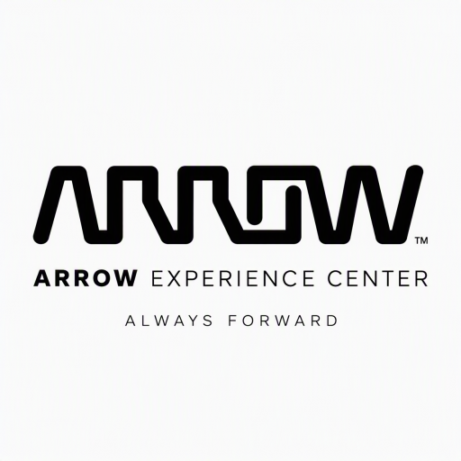

# IBM Bob — Arrow Experience Center



This repository is the home for **IBM Bob** running in our **Arrow Experience Center** on **IBM Fusion on-prem**.

All folders and repositories in this space are created with Bob — an AI-powered software engineering agent that assists with writing, modifying, and refactoring code across many programming languages, frameworks, and best practices.

## Repository layout

Each project lives in its own self-contained folder under `projects/`:

```
bob/
├── README.md              # This file — repo overview
├── assets/
│   └── design-image.png   # Dropped design image
└── projects/
    └── bob/               # Apache httpd webpage project
        ├── Dockerfile
        ├── README.md
        ├── index.html
        ├── test_index.py
        └── assets/
            └── bob-logo.png
```

## Bob project

The [`projects/bob/`](projects/bob/) folder contains the first project: a static Apache httpd container webpage about Bob running on IBM Fusion on-prem at the Arrow Experience Center.

- [`Dockerfile`](projects/bob/Dockerfile) — builds an Apache httpd 2.4 (Alpine) container serving `index.html`
- [`index.html`](projects/bob/index.html) — webpage content about Bob, IBM Fusion on-prem, and the Arrow Experience Center
- [`README.md`](projects/bob/README.md) — build and run instructions for the Bob webpage
- [`test_index.py`](projects/bob/test_index.py) — 11 unit tests validating the webpage content

### Build and run the Bob webpage

```bash
cd projects/bob
docker build -t bob-apache .
docker run --rm -p 8080:80 bob-apache
```

Open http://localhost:8080 in your browser.

## Adding more projects

To add a new project, create a new folder under `projects/`:

```
projects/
├── bob/                   # existing project
└── <new-project>/         # your next project
    ├── Dockerfile
    ├── index.html
    ├── README.md
    └── test_*.py
```

Each project is independent and self-contained. All are created with Bob.

## About

Built and maintained by Bob on IBM Fusion on-prem, Arrow Experience Center.
